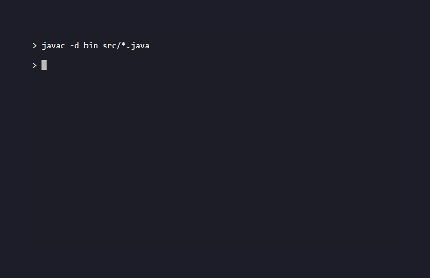

# Sokoban Solver 

A command-line program built in java that finds the optimal solution of Sokoban levels using the A* pathfinding algorithm

## How it works:

- **State Representation:** The position of the player and the boxes in the level is represented by the `SokobanState` class
- **Move Generation:** Valid moves from any given board state are generated by the `move()` methods in `SokobanState`.
- **Heuristic Scoring:** Each board state is assigned a score-the lower the score the closer it is to the solution. Two heuristic functions are available for the scoring:
  - Manhattan Distance of boxes and goals
  - Count of misplaced boxes
- **Deadlock Detection:** An optional `deadlockDetection` method scans the board for stuck boxes and immediately penalizes the state's score so the solver avoids dead ends. 
- **Solution Checking:** The `isFinal()` method checks if the current state is the solution of the level.

**Program Flow**
1. The initial state is passed into the `aStar` method of the `SokobanSolver` class
2. Starting from the initial state, the algorithm generates all valid child states, using a closed set to avoid redundant checks.
3. When the `isFinal()` method evaluates to `true`, the path is reversed and printed to the console.

**Level Representation**
- Each level is represented by a combination of different characters:
  
  | Character |Meaning |
  | :------: | :-------: | 
  | #  | Wall |
  | @  | Player |
  | * | Goal |
  | $ | Box | 
  | + | Player on Goal | 
 
### Example run

